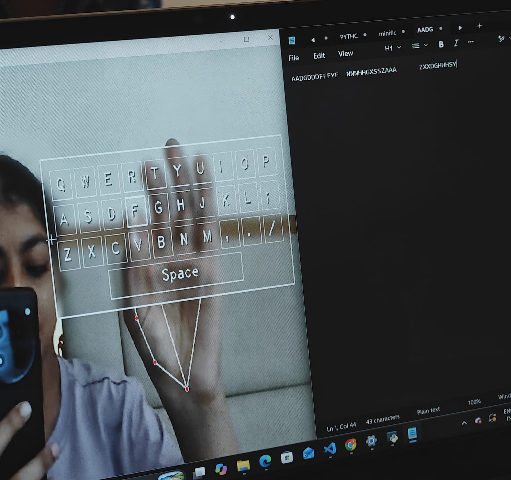

# Virtual Keyboard and Mouse Controller

control your computer with hand gestures — no physical keyboard or mouse required.

A Python-based computer vision project that uses a webcam to detect hand movements and perform keyboard and mouse actions in real time.

## Overview

The project uses MediaPipe for hand tracking and OpenCV for real-time video processing. Finger movements and pinch gestures are detected to perform keyboard and mouse operations.

## Project Output



Features
- Real-time hand detection and tracking.
- Virtual keyboard displayed through the webcam feed.
- Keyboard input using right-hand pinch gestures.
- Mouse cursor movement using the left hand.
- Mouse clicks through pinch gestures.
- Real-time visual feedback.

## Technologies Used

| Technology | Purpose |
|---|---|
| Python | Core programming language |
| OpenCV | Webcam access and image processing |
| MediaPipe | Hand landmark detection |
| NumPy | Coordinate mapping |
| Pynput | Keyboard and mouse automation |

## Project Workflow

1. OpenCV captures live video from the webcam.
2. MediaPipe detects and tracks hand landmarks.
3. The distance between the thumb and index finger is calculated.
4. The right hand interacts with the virtual keyboard.
5. The left hand controls mouse movement and clicks.
6. Pynput executes the corresponding keyboard and mouse actions.

## Installation and Setup

**1. Download the repository**

Go to the GitHub repository, select **Code → Download ZIP**, and extract the downloaded folder.

**2. Open the project in VS Code**

Open the extracted folder and launch the integrated terminal.

**3. Create a virtual environment**

```bash
py -3.12 -m venv venv
venv\Scripts\activate
```

**4. Install dependencies**

```bash
pip install -r requirements.txt
```

For the tested environment, use Python 3.12, MediaPipe 0.10.21 and OpenCV contrib 4.11.0.86.

If necessary, install the compatible versions using:

```bash
pip uninstall opencv-python opencv-python-headless opencv-contrib-python-headless -y
pip install mediapipe==0.10.21
pip install opencv-contrib-python==4.11.0.86 --no-deps
```

## Run the Application

```bash
python key.py
```

Ensure that webcam access is enabled.

## Expected Output

On successful execution, a window titled **Virtual Keyboard** opens and displays the live webcam feed with a virtual keyboard overlay and hand tracking landmarks.

Users can:
- Select and type keys using the right hand.
- Move the mouse cursor using the left hand.
- Perform mouse clicks using a pinch gesture.

Press `q` to close the application.

## Learning Outcomes

- Practical implementation of Python programming.
- Understanding computer vision and real-time image processing.
- Hand landmark detection using MediaPipe.
- Coordinate mapping and distance calculations.
- Keyboard and mouse automation.
- Dependency management and debugging.

## Requirements

- Python 3.12
- Working webcam
- Windows operating system
- Required Python dependencies

